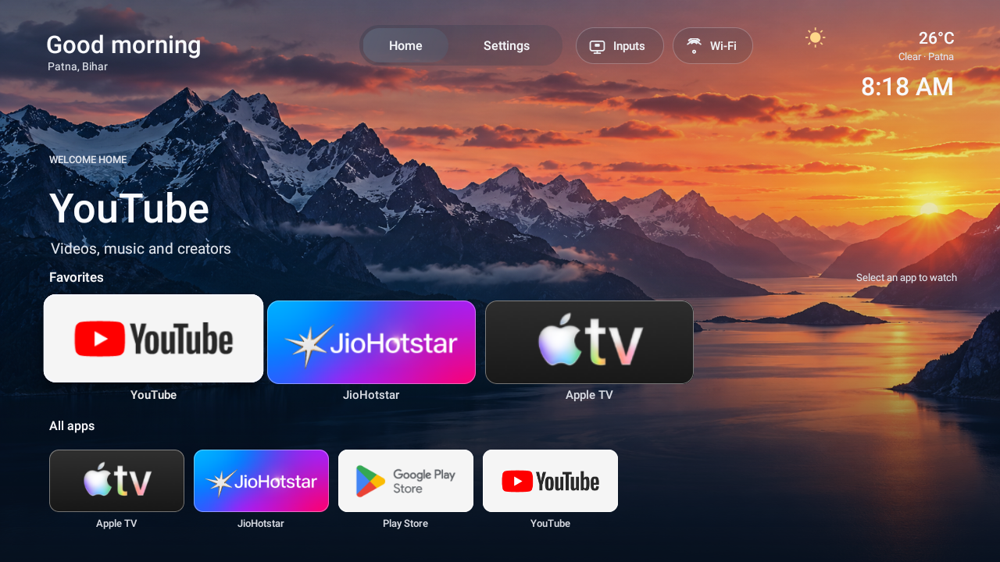

# Luma Home

A remote-first Android TV launcher built for a Mi TV 4I running Android TV 9. It is based on the MIT-licensed [TV Detox](https://github.com/Ansub/tv-detox) project and keeps the same Android package ID used on this TV: `com.ansub.tvhome.stylish`.



The home screen has a mountain wallpaper, a greeting based on the TV clock, a fixed **Patna, Bihar** location, current Patna weather, and a large clock. Favorites are YouTube, JioHotstar, and Apple TV. A separate All apps row discovers newly installed launchable apps automatically. Play Store appears there; Live TV is hidden from that row. The **Inputs** button still lists AV and HDMI sources and opens the TV's input screen. Settings and Wi-Fi shortcuts remain in the header.

No IMDb key or recommendation service is used. The only network requests the launcher makes are to [Open-Meteo](https://open-meteo.com/en/docs) for Patna weather, about every 30 minutes while Home is open. It does **not** look up the TV's location. The last successful weather result is cached locally.

## Build

Install Java 17, Android platform-tools (`adb`), Android SDK platform 34, and build-tools 34.0.0. On macOS, Android Studio or the Android command-line tools can provide the SDK.

```sh
export ANDROID_HOME="$HOME/Library/Android/sdk"
./build.sh
```

The APK is written to `out/luma-home.apk`. The first build creates a private signing key in `.local/key.jks`. Both `.local/` and `out/` are ignored by Git. **Keep that key privately:** Android requires updates to be signed with the same key as the installed app.

To update the existing Luma Home installation on this TV, build with its original private key, held outside this repository:

```sh
KEYSTORE=/path/to/existing/key.jks KEYSTORE_PASS='<existing password>' ./build.sh
```

The installer will report a signing mismatch; it will not uninstall the existing launcher automatically.

## Install on an Android TV

Enable developer options and ADB debugging on the TV. Connect the TV and laptop to the same network, approve the TV's **Allow debugging** prompt, then run:

```sh
./install.sh <TV_IP>
```

`install.sh` builds if needed, installs the APK, opens it, sets it as the default HOME app, and checks that the setting took effect. It does not remove or disable any TV packages. The TV's physical input services must remain enabled.

## Customize

- **Favorites and order:** edit `appList()` in `src/com/ansub/tvhome/MainActivity.java`.
- **All apps exclusions:** edit `allLaunchableApps()` in the same file. `com.android.tv` is intentionally hidden because its separate input screen is still used by the **Inputs** button.
- **City and weather:** the displayed city and fixed Patna coordinates are in `MainActivity.java`. Change both if using this elsewhere.
- **Wallpaper:** replace `assets/luma_landscape.png` and rebuild.

## Current TV setup

The owner's TV uses Luma Home as its default launcher and is configured to stay awake while powered. The original TV Detox Home, Sony LIV, and TV Guide were removed for the current TV user. Android TV Leanback Launcher, both Android screensavers, and Mi TV Manager were disabled. Google TV Launcher was already disabled. These device changes are **not** made by `install.sh`; they are recorded in [prompt.md](prompt.md) so installing this launcher on another TV does not silently modify its apps or power settings.

Live TV (`com.android.tv`) stays installed and enabled because selecting AV or HDMI through **Inputs** opens its input activity. The launcher's All apps row simply omits its tile. On the Mi TV 4I, selecting HDMI 1 from the Inputs button was verified after this change.

## Project files

| File | Purpose |
| --- | --- |
| `src/com/ansub/tvhome/MainActivity.java` | Launcher UI, app discovery, input menu, and weather |
| `AndroidManifest.xml` | HOME registration and Android permissions |
| `assets/luma_landscape.png` | Home-screen wallpaper |
| `build.sh` | Compile and sign the APK |
| `install.sh` | Install and set default HOME over ADB |
| `prompt.md` | Copyable build prompt and this TV's decisions |

The project is distributed under the [MIT License](LICENSE), preserving the original TV Detox copyright notice.
